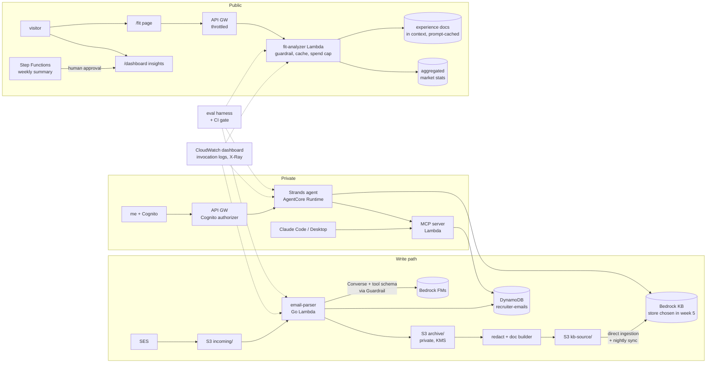

# Recruiter Intelligence

A 12-week GenAI project built on the existing Recruiter Dashboard, planned to run alongside
studying for the **AWS Certified Generative AI Developer – Professional (AIP-C01)** exam.

| File | What it holds |
|---|---|
| [`PLAN.md`](PLAN.md) | The week-by-week plan: build tasks, exam skills, study, definition of done |
| [`EXAM-COVERAGE.md`](EXAM-COVERAGE.md) | Every AIP-C01 skill (98 of them) mapped to the week that exercises it, or marked study-only |
| [`DECISIONS.md`](DECISIONS.md) | Architecture decisions, each with the alternatives and why they lost |
| [`TRACKING.md`](TRACKING.md) | How the plan is tracked in a GitHub Project with milestones and issues, plus the next steps |
| [`JOURNAL.md`](JOURNAL.md) | A weekly log template. It becomes the raw material for the case study in week 12 |

## The goal

Finish with **three things a hiring manager can click on**, all grounded in the recruiter emails
this site already receives:

1. **Job-Fit Analyzer** (public, `/fit`). Paste a job description and get a structured,
   cited analysis of how well it fits my experience and what the recruiter market says about
   roles like it. This fulfils the "Coming Soon" teaser at `src/pages/HomePage.jsx:149-181`.
2. **Market Insights** (public, extending `/dashboard`). Trends from enriched extraction
   (seniority, remote/hybrid/onsite, stack, employment type), plus a weekly AI-written market
   summary that a human approves before it is published.
3. **Inbox Assistant** (private, behind Cognito, only me). A RAG + agent assistant over the
   full recruiter corpus, also exposed as an MCP server so Claude Code and Claude Desktop can
   query it.

Plus a **public eval scorecard** and a **case study page**. The scorecard and the write-up are
what separate this from a demo.

## Starting point (as of v1.9.1, 25 Oct 2026)

What exists, from a read of the repository:

- **Write path:** SES → S3 `incoming/` → `email-parser` Lambda (Go) → OpenAI `gpt-5-nano`
  structured extraction of 7 fields → DynamoDB `recruiter-emails`.
  See `docs/architecture-recruiter-dashboard.md`.
- **Read path:** API Gateway (REST, `dashboard-api.sh3r4rd.com`) → `api-handler` Lambda (Go),
  which returns an allowlist of fields (`id, company, jobTitle, month, recruiterLabel,
  confidence`) → `/dashboard`.
- **No Bedrock anywhere.** No IAM grant, no Terraform, no code.

Gaps found in that read. Each one becomes a task in the plan:

| Gap | Where | Fixed in |
|---|---|---|
| ⚠️ **Raw emails are hard-deleted after 30 days.** This is the only durable copy of every email body. DynamoDB stores the extracted fields and the subject line, never the body. Versioning is off and there is no archive | `infra/recruiter-dashboard/modules/s3/main.tf:15-30` | **Week 0, today** |
| The full email body goes to a third-party LLM, capped only by the 10 MB raw-fetch limit (`handler.go:25`). `sanitizer.Truncate` exists but only its own test calls it | `lambda-src/email-parser/internal/extractor/extractor.go`, `internal/handler/handler.go:152` | Week 3 |
| `confidence` is self-reported by the model and nothing acts on it | `internal/handler/handler.go` | Weeks 2–3 |
| No eval harness. Extractor tests use a mocked client | `internal/extractor/*_test.go` | Week 2 |
| The `ParseFailures` alarm can never fire because nothing emits the metric | `modules/monitoring/main.tf:63-81` | Week 10 |
| Per-record failures are swallowed, so the Lambda `Errors` alarm rarely moves | `internal/handler/handler.go:115-220` | Week 10 |
| The recruiter email the model extracted is written to the S3 `sender` tag | passed in at `internal/handler/handler.go:211`, written by `internal/tagger/tagger.go:42-68` | Week 8 |

## Target architecture (end of week 12)

The two halves never share an index. **Public surfaces read only aggregated statistics and my
own experience documents, never recruiter email text.** See `DECISIONS.md` § D-04.

## Ground rules

- **Evals before features.** No prompt, model or retrieval change ships without a number from
  the eval harness next to it. Week 2 builds the harness before week 3 changes the extractor.
- **The repository's own rules still apply.** `AGENTS.md:152-160` lists ask-first actions: new routes
  in `App.jsx`, new npm or Go dependencies, Terraform changes, DynamoDB schema or API Gateway
  configuration changes, API payload changes, Lambda signatures and workflow changes. This plan touches all of them, so every week lists its
  **approval gates**. Approving the plan is not approving each PR.
- **Spend is capped in code and alarmed in AWS.** A public LLM endpoint without both is a bill
  waiting to happen. See week 1 (budgets) and week 9 (the per-day kill switch).
- **Conventional commits and the existing branch model** (epic branch → `feat/{n}-{slug}` PRs,
  tracked in GitHub Issues, per `.claude/plans/implementation-notes.md`).

## Where code will live

| Component | Path | Language |
|---|---|---|
| Extraction v2, archive writer | `infra/recruiter-dashboard/lambda-src/email-parser/` (existing) | Go |
| Document builder (redaction) | `infra/recruiter-dashboard/lambda-src/doc-builder/` | Go |
| MCP server | `infra/recruiter-dashboard/lambda-src/mcp-server/` | Go or Python, decided in week 7 (D-03) |
| Fit analyzer | `infra/recruiter-dashboard/lambda-src/fit-analyzer/` | Go |
| Agent | `infra/recruiter-dashboard/agent-src/inbox-agent/` | Python (Strands) |
| Eval harness, schemas, synthetic data, aggregate reports | `infra/recruiter-dashboard/evals/` (repo) | Python |
| Terraform | new modules under `infra/recruiter-dashboard/modules/` (`bedrock`, `knowledge-base`, `cognito`, `agent`) | HCL |
| Frontend | `src/pages/FitPage.jsx`, `src/pages/AssistantPage.jsx`, `src/components/sections/insights/` | JSX |

Golden datasets built from real emails contain PII and **never get committed**. They live in the
private bucket under the `evals/` S3 prefix.

Throughout the plan, `evals/...` with no other root means the repository directory
`infra/recruiter-dashboard/evals/`, and `s3://…/evals/...` means the private prefix. Only synthetic fixtures and their schemas go in git (D-06).
